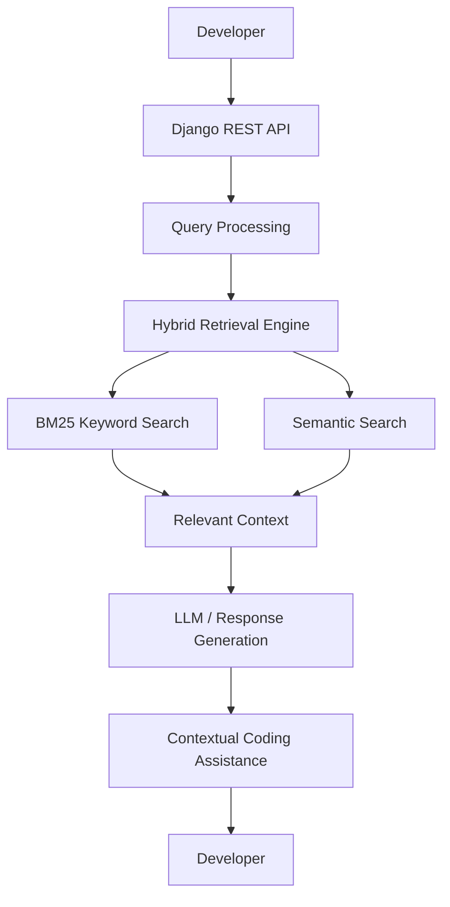
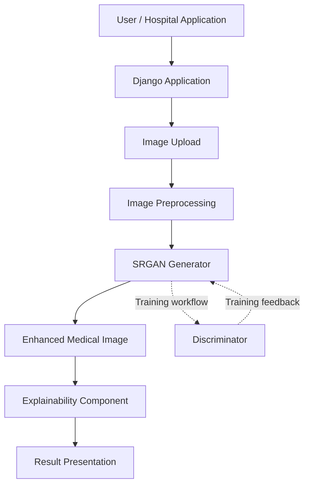
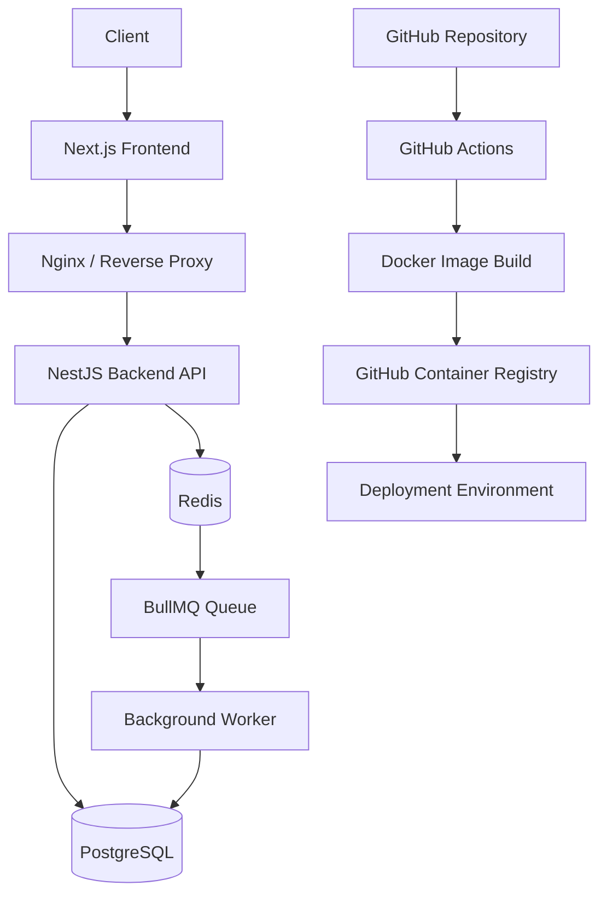

# Vivek Venugopal

### Software Engineer | Backend Engineering | AI/ML | Full Stack | Cloud & DevOps

\

&#x20; \<a href="[https://github.com/Vivek-Venugopal-Gits](https://github.com/Vivek-Venugopal-Gits)">
&#x20;   \
&#x20; \</a>
&#x20; \<a href="[https://linkedin.com/in/vivek-venugopal-dev/](https://linkedin.com/in/vivek-venugopal-dev/)">
&#x20;   \
&#x20; \</a>
&#x20; \<a href="mailto\:kousthubham.vivek\@gmail.com">
&#x20;   \
&#x20; \</a>
\

---

## About Me

I'm a Software Engineer with a Computer Science and Engineering background, currently working at **Lealabs Private Limited**, where I contribute to backend engineering and cross-platform application development.

My engineering interests span **Backend Development, Artificial Intelligence, Machine Learning, Full Stack Engineering, and Cloud Infrastructure**. I enjoy understanding systems from the ground up, translating requirements into technical solutions, and building applications that solve practical problems.

My professional experience has primarily involved Python, Django REST Framework, RESTful APIs, database integration, and Flutter. Alongside my professional work, I've explored AI-powered applications, information retrieval, deep learning, and distributed application infrastructure through independent projects.

I believe good engineering goes beyond writing code. It involves understanding the problem, evaluating different approaches, making thoughtful architectural decisions, optimizing performance, and taking ownership of the final implementation.

I'm continuously expanding my engineering capabilities, currently focusing on **AI/ML Engineering, Cloud Infrastructure, DevOps, and scalable system design**.

## Technical Skills & Technologies

My technical stack is organized around the areas I've worked with, explored through projects, and am actively developing.

### Programming Languages

\

&#x20; \
&#x20; \
&#x20; \
&#x20; \
&#x20; \
&#x20; \
&#x20; \
\

### Backend Engineering

\

&#x20; \
&#x20; \
&#x20; \
&#x20; \
&#x20; \
&#x20; \
\

- RESTful API design and development
- Object-Oriented Programming and modular architecture
- API integration and backend-model communication
- Authentication and application-level authorization
- Database integration and query optimization
- Background processing and asynchronous task execution

### Frontend & Application Development

\

&#x20; \
&#x20; \
&#x20; \
&#x20; \
&#x20; \
\

- Cross-platform mobile and web application development
- Flutter and Dart application architecture
- API-driven frontend integration
- Responsive UI development
- Component-based application development

### Artificial Intelligence & Machine Learning

\

&#x20; \
&#x20; \
&#x20; \
&#x20; \
&#x20; \
\

- Retrieval-Augmented Generation (RAG)
- Hybrid Information Retrieval
- BM25 and Semantic Search
- AI Agent development
- LSTM-based sequence prediction
- Generative Adversarial Networks (GANs)
- Super-Resolution Generative Adversarial Networks (SRGAN)
- Explainable AI concepts

### Databases & Data Infrastructure

\

&#x20; \
&#x20; \
&#x20; \
&#x20; \
&#x20; \
\

- Relational and NoSQL database concepts
- Data modeling and schema design
- Database integration and query handling
- Caching and in-memory data storage
- Redis-backed background job processing

### Cloud, DevOps & Infrastructure

\

&#x20; \
&#x20; \
&#x20; \
&#x20; \
&#x20; \
&#x20; \
\

- Docker and containerized application deployment
- Docker Compose and multi-container environments
- CI/CD pipelines using GitHub Actions
- AWS EC2 and S3 exposure
- Linux fundamentals and server administration
- Reverse proxy and deployment architecture
- Redis and BullMQ background workers

### Development Tools & Engineering Practices

\

&#x20; \
&#x20; \
&#x20; \
&#x20; \
&#x20; \
&#x20; \
\

- Git-based version control and collaboration
- Debugging and application troubleshooting
- Code reviews and performance optimization
- Object-Oriented Design and Data Structures
- Testing and API validation
- Technical documentation and architecture planning

---

## Professional Experience

### Software Engineer — Lealabs Private Limited

**Kochi, Kerala, India | Current**

Working across backend engineering and cross-platform application development.

- Develop and maintain backend services using Python and Django REST Framework.
- Design and implement RESTful APIs for application features and integrations.
- Contribute to Flutter-based mobile and web applications using Dart.
- Work with database integration, application models, and backend business logic.
- Investigate and resolve backend and frontend integration issues.
- Participate in code reviews, testing, debugging, and performance improvements.
- Focus on maintainable code, modular architecture, and production reliability.

**Technologies:** Python, Django, Django REST Framework, Dart, Flutter, REST APIs, Databases.

### Backend Development Intern — KLAW

**Lealabs Private Limited**

- Worked on backend development using Python and Django REST Framework.
- Contributed to API implementation and backend functionality.
- Gained practical experience with application logic, database interactions, and backend development workflows.

---

## Featured Engineering Projects

My projects reflect my interest in solving different engineering problems, from intelligent information retrieval to deep learning and cloud-native application infrastructure.

### 01. Django Framework-Specific AI Coding Assistant Agent

**Python | Django | REST APIs | RAG | BM25 | Semantic Search**

An AI-powered coding assistant designed to retrieve framework-specific technical information and provide contextually relevant assistance to developers.

**Key Contributions**

- Developed a Django-based AI coding assistant using retrieval-augmented generation.
- Implemented a hybrid retrieval approach combining BM25 keyword search and semantic search.
- Designed the retrieval workflow to improve the relevance of framework-specific information.
- Worked on retrieval optimization, achieving a reported 86.7% improvement in the project's retrieval evaluation.

**Architecture:**

[View AI Agent Architecture](#ai-coding-assistant-architecture)

### 02. Medical Image Enhancement using SRGAN

**Python | Django | Deep Learning | SRGAN | Explainable AI**

A medical image enhancement application exploring deep learning-based super-resolution techniques.

**Key Contributions**

- Implemented an SRGAN-based image enhancement workflow.
- Integrated the enhancement model into a Django application.
- Organized model and application components for image processing.
- Explored explainability concepts for understanding AI-generated results.
- Developed application functionality around authentication and hospital-oriented access workflows.

**Architecture:**

[View SRGAN Architecture](#medical-image-enhancement-architecture)

### 03. VEGAH Cloud Platform

**Next.js | NestJS | PostgreSQL | Redis | BullMQ | Docker | GitHub Actions | AWS**

A cloud-oriented application infrastructure project developed to explore containerization, asynchronous processing, CI/CD, and deployment architecture.

**Key Contributions**

- Developed a multi-service application architecture with separate frontend, backend, and worker services.
- Integrated PostgreSQL for persistent data storage.
- Implemented Redis-backed background job processing using BullMQ.
- Containerized services using Docker and Docker Compose.
- Configured CI/CD workflows using GitHub Actions.
- Built and published container images to GitHub Container Registry.
- Explored deployment architecture involving AWS EC2 and reverse proxy configuration.

**Architecture:**

[View VEGAH Architecture](#vegah-cloud-platform-architecture)

### 04. Rock Paper Scissors — Sequence Prediction Game

**Python | LSTM | Machine Learning**

An interactive game exploring sequential pattern recognition and predictive modeling.

**Key Contributions**

- Implemented an LSTM-based sequence prediction model.
- Designed the game to learn from previous player moves.
- Integrated prediction logic into the gameplay workflow.
- Observed approximately 89% blocking success by round 10 in the project's evaluation.

### 05. Furniture Store — Flutter E-commerce Application

**Flutter | Dart | JSON | Local Assets**

A cross-platform shopping application focused on frontend functionality and user interaction.

**Key Contributions**

- Developed product browsing and discovery features.
- Implemented search, filtering, and sorting.
- Integrated local JSON product data and image assets.
- Developed login flows and application navigation.

---

## Project Architecture

The following diagrams provide high-level views of the major systems I've worked on. They represent conceptual application flows rather than complete deployment specifications.

### AI Coding Assistant Architecture

### Medical Image Enhancement Architecture

### VEGAH Cloud Platform Architecture

---

## Engineering & Problem-Solving

I believe strong engineering fundamentals are essential regardless of the technology stack.

Areas I continuously work on:

- Data Structures and Algorithms
- Problem-solving and competitive programming
- Object-Oriented Programming
- System design fundamentals
- Backend architecture and API design
- Database concepts and optimization
- Application performance and reliability
- Distributed processing fundamentals

I approach technical problems by understanding their constraints, evaluating possible solutions, and considering their impact on performance, maintainability, and scalability.

---

## Leadership & Community Contributions

### TinkerHub — College of Engineering and Management Punnapra

**Campus Lead | Academic Year 2025–2026**
**Outreach Lead | 2024–2025**

Contributed to the campus developer community by helping students explore technology, collaborate, and develop practical engineering skills.

- Mentored 20+ students in Full Stack Web Development.
- Supported hands-on learning initiatives in hardware and IoT.
- Organized and contributed to Prompt Engineering and Machine Learning workshops.
- Helped students explore development tools, emerging technologies, and practical projects.
- Contributed to community-building and technical knowledge-sharing initiatives.
- Participated in the campus team's efforts that earned Campus of the Year Runner-Up recognition.

I value collaborative learning and believe that sharing technical knowledge is an important part of becoming a better engineer.

---

## Current Learning Roadmap

My current focus is to build stronger engineering fundamentals while expanding into modern AI and infrastructure technologies.

| Area                   | Current Focus                                            |
| ---------------------- | -------------------------------------------------------- |
| AI/ML Engineering      | AI agents, RAG, LLM applications, retrieval optimization |
| Backend Engineering    | Advanced Django, FastAPI, API architecture, scalability  |
| Full Stack Development | Frontend architecture and application integration        |
| DevOps                 | Docker, CI/CD, Linux, deployment automation              |
| Cloud Engineering      | AWS infrastructure, EC2, S3, deployment architecture     |
| System Design          | Distributed systems, caching, queues, reliability        |
| Problem Solving        | DSA, algorithms, and competitive programming             |

### What I'm Working Towards

1. Deepening my understanding of AI/ML engineering and production-ready AI applications.
2. Becoming more proficient in cloud infrastructure and DevOps practices.
3. Building and deploying scalable full-stack applications.
4. Strengthening system design, problem-solving, and software architecture fundamentals.
5. Developing the ability to take complete ownership of engineering projects, from initial planning to production deployment.

---

## My Vision & Engineering Philosophy

My ambition is to become an engineer who can do more than implement assigned features. I want to understand complex problems, design systems from the ground up, build intelligent and scalable solutions, and contribute to products that create meaningful real-world impact.

I'm particularly interested in the intersection of software engineering, artificial intelligence, and infrastructure. I see these areas as complementary disciplines that enable engineers to build increasingly capable products and systems.

In the long term, I aspire to take on greater technical responsibility, lead engineering initiatives, work alongside people who challenge me to think differently, and eventually build something of my own.

I don't want to limit myself to a particular technology or framework. My goal is to develop strong engineering fundamentals, continuously adapt to evolving technologies, and become someone capable of turning ambitious ideas into working products.

**I believe the best engineers never stop learning, questioning, experimenting, and building.**

---

## Education

**Bachelor of Technology — Computer Science and Engineering**

College of Engineering and Management Punnapra
APJ Abdul Kalam Technological University (KTU)
Graduation: 2026

---

## Let's Connect

I'm always interested in connecting with engineers, developers, founders, and technology enthusiasts who enjoy building meaningful products and exploring new ideas.

\
   \<a href="[https://github.com/Vivek-Venugopal-Gits](https://github.com/Vivek-Venugopal-Gits)">     \   \</a>   \<a href="[https://linkedin.com/in/vivek-venugopal-dev/](https://linkedin.com/in/vivek-venugopal-dev/)">     \   \</a>   \<a href="mailto\:kousthubham.vivek\@gmail.com">     \   \</a> \

\
   \<i>Learning continuously. Engineering thoughtfully. Building relentlessly.\</i> \

