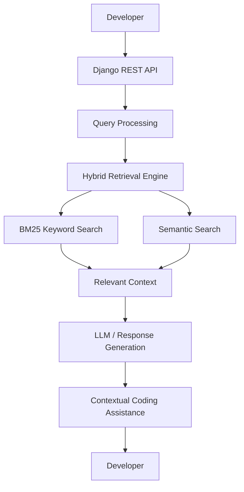
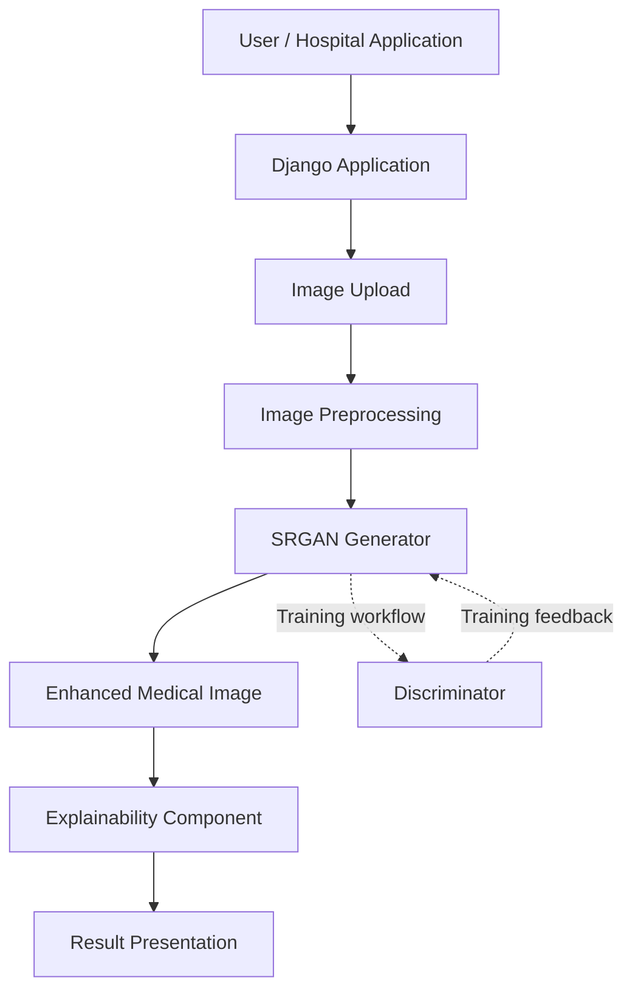
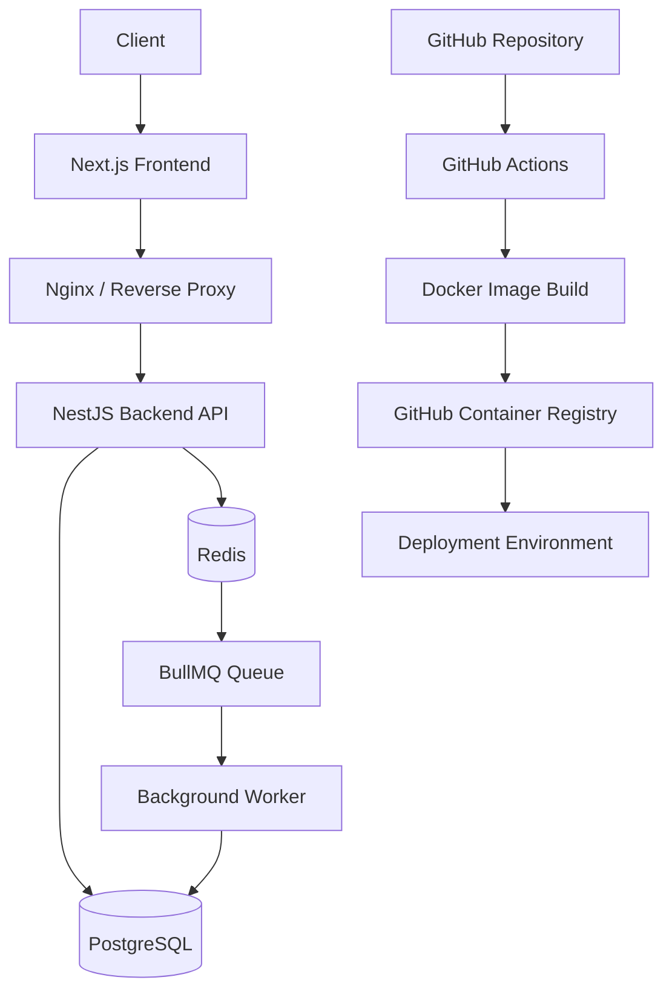

<h1 align="center">Vivek Venugopal</h1>

  Software Engineer · Backend · AI/ML · Full Stack · Cloud &amp; DevOps

  
  
  

---

## About

Software Engineer with a Computer Science and Engineering background, currently at **Lealabs Private Limited**, working on backend services and cross-platform applications.

My professional work centers on **Python, Django REST Framework, RESTful APIs, database integration, and Flutter**. Outside of work, I build projects in **AI-powered applications, information retrieval, deep learning, and containerized infrastructure**.

I focus on understanding the problem first, weighing approaches, making deliberate architectural decisions, and owning the implementation through to production.

**Currently focused on:** AI/ML engineering · Cloud infrastructure · DevOps · Scalable system design

---

## Tech Stack

  
  
  
  
  
  
  
  
  
  
  
  
  
  
  
  
  

| Area | Technologies |
| :-- | :-- |
| **Languages** | Python, Dart, JavaScript, SQL, HTML, CSS |
| **Backend** | Django, Django REST Framework, FastAPI, Node.js, REST API design |
| **Frontend & Mobile** | Flutter, React, Next.js, Angular, React Native |
| **AI / ML** | RAG, hybrid retrieval (BM25 + semantic search), AI agents, LSTM, GAN / SRGAN, Explainable AI |
| **Data** | PostgreSQL, MySQL, MongoDB, Redis, SQLite |
| **Cloud & DevOps** | AWS (EC2, S3), Docker, Docker Compose, GitHub Actions, Nginx, Linux |
| **Tooling** | Git, GitHub, Postman, Ollama, Figma |

---

## Experience

### Software Engineer · Lealabs Private Limited
*Kochi, Kerala, India · Present*

- Build and maintain backend services using Python and Django REST Framework.
- Design and implement RESTful APIs for product features and integrations.
- Contribute to Flutter (Dart) mobile and web applications.
- Resolve backend and frontend integration issues across the stack.
- Participate in code reviews, testing, debugging, and performance improvements.

**Stack:** Python, Django, Django REST Framework, Dart, Flutter, REST APIs, SQL databases

### Backend Development Intern · KLAW (Lealabs Private Limited)

- Developed backend functionality and API endpoints with Python and Django REST Framework.
- Gained hands-on experience with application logic, database interactions, and backend workflows.

---

## Featured Projects

### Django Framework-Specific AI Coding Assistant
`Python` `Django` `REST APIs` `RAG` `BM25` `Semantic Search`

An AI coding assistant that retrieves framework-specific documentation and returns contextually relevant answers to developers.

- Built a retrieval-augmented generation pipeline on Django.
- Implemented hybrid retrieval combining BM25 keyword search with semantic search.
- Optimized the retrieval workflow, reporting an **86.7% improvement** in the project's retrieval evaluation.

### Medical Image Enhancement using SRGAN
`Python` `Django` `Deep Learning` `SRGAN` `Explainable AI`

A medical image enhancement application using deep learning–based super-resolution.

- Implemented an SRGAN-based enhancement workflow and integrated it into a Django application.
- Explored explainability techniques to interpret model output.
- Built authentication and access workflows oriented toward hospital use.

### VEGAH Cloud Platform
`Next.js` `NestJS` `PostgreSQL` `Redis` `BullMQ` `Docker` `GitHub Actions` `AWS`

A multi-service platform built to explore containerization, asynchronous processing, CI/CD, and deployment architecture.

- Designed separate frontend, backend, and worker services.
- Implemented Redis-backed background job processing with BullMQ and PostgreSQL for persistence.
- Containerized services with Docker Compose and automated builds with GitHub Actions, publishing images to GitHub Container Registry.
- Explored deployment on AWS EC2 behind an Nginx reverse proxy.

### Rock Paper Scissors: Sequence Prediction
`Python` `LSTM` `Machine Learning`

An interactive game that uses an LSTM model to learn from a player's previous moves and predict the next one, reaching roughly **89% blocking success by round 10** in the project's evaluation.

### Furniture Store: Flutter E-commerce App
`Flutter` `Dart` `JSON`

A cross-platform shopping app featuring product browsing, search, filtering, sorting, login flow, and navigation, driven by local JSON data and image assets.

---

## Architecture Overview

High-level conceptual flows of the major projects.

<b>AI Coding Assistant</b>

<b>Medical Image Enhancement</b>

<b>VEGAH Cloud Platform</b>

---

## Community & Leadership

**TinkerHub · College of Engineering and Management Punnapra**
*Campus Lead (2025–2026) · Outreach Lead (2024–2025)*

- Mentored 20+ students in full stack web development.
- Organized workshops on prompt engineering, machine learning, and hardware/IoT.
- Part of the campus team recognized as **Campus of the Year Runner-Up**.

---

## Current Focus

| Area | Focus |
| :-- | :-- |
| AI/ML Engineering | AI agents, RAG, LLM applications, retrieval optimization |
| Backend | Advanced Django, FastAPI, API architecture, scalability |
| DevOps & Cloud | Docker, CI/CD, Linux, AWS (EC2, S3), deployment automation |
| System Design | Distributed systems, caching, queues, reliability |
| Fundamentals | Data structures, algorithms, problem solving |

---

## Education

**B.Tech, Computer Science and Engineering** · 2026
College of Engineering and Management Punnapra · APJ Abdul Kalam Technological University (KTU)

---

## Let's Connect

I'm open to conversations with engineers, founders, and teams building meaningful products.

  
  
  

